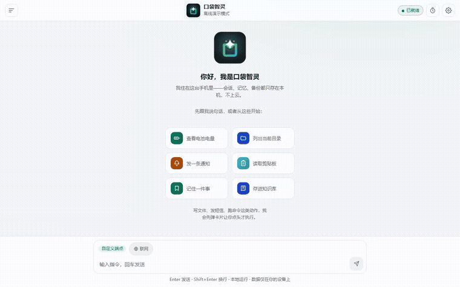
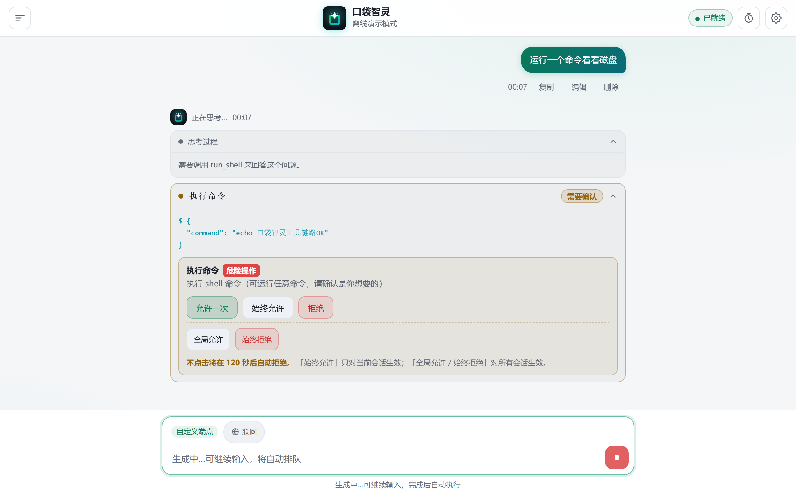
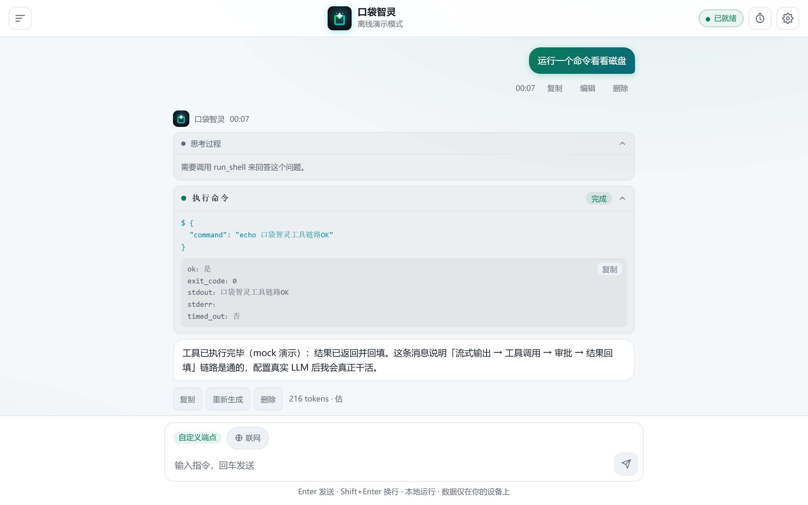
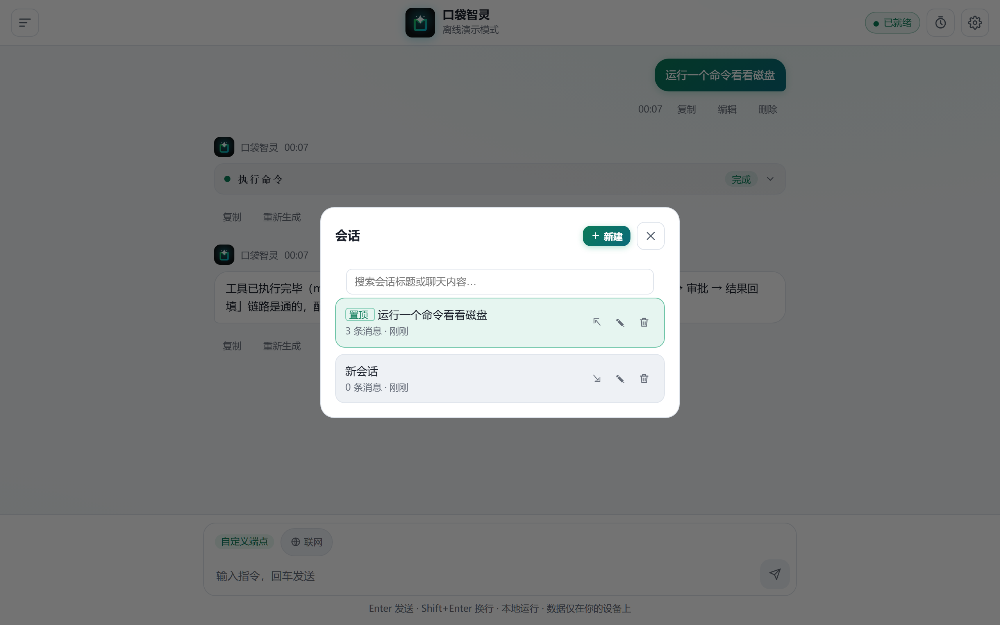
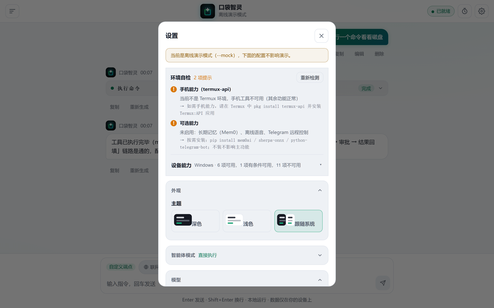
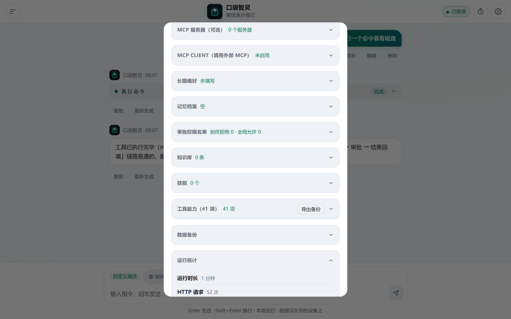
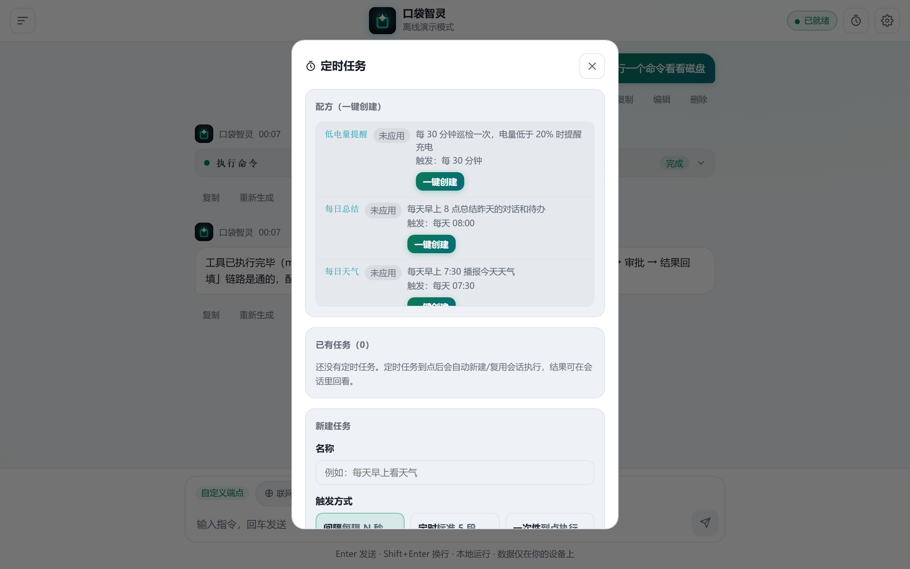
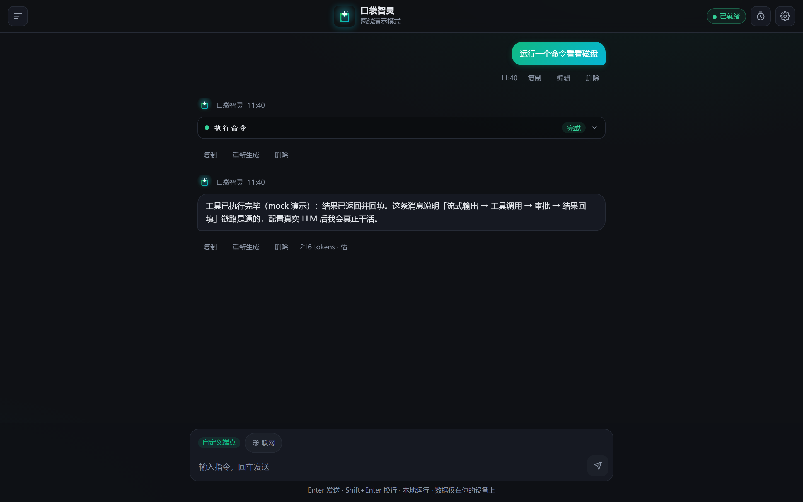
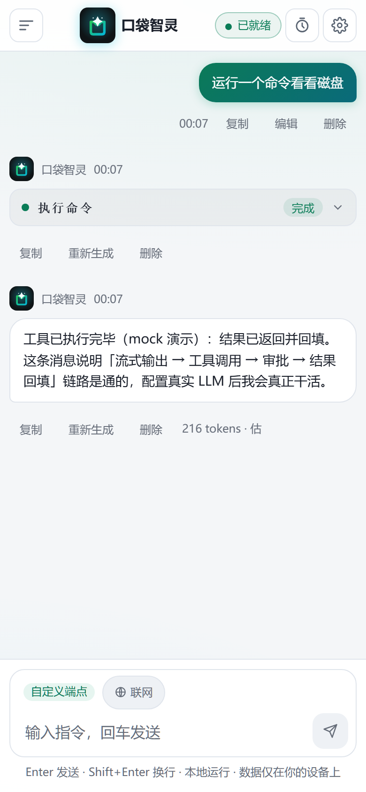

<div align="center">
  
  <h1>PocketMind · 口袋智灵</h1>
  <p><b>The always-on Agent that actually operates your phone — right from your pocket.</b><br/>
  Local-first · Privacy-first · Native on Termux · 41 tools · Server-enforced approval</p>
  
  
  
  
  
  <br />
  <sub>Web UI · PWA · APK · MCP Server + Client · Telegram Gateway · Recipes · Plan/Act Modes · Backup &amp; Restore</sub>
</div>

**[English](README.md)** | [简体中文](README.zh-CN.md)

---

## Demo



<sub>Recorded from the running app (mock LLM, no API key needed): empty state → tool call →
server-side approval → result → sessions → settings → live statistics → scheduled jobs →
dark theme → mobile viewport. Full video: [docs/demo/pocketmind-demo.mp4](docs/demo/pocketmind-demo.mp4) (39 s).</sub>

## Why this exists

Every other agent runs on your laptop and treats the phone as a peripheral.
PocketMind runs **on the phone itself** and treats the phone's own capabilities as its tools:
SMS, calls, GPS, sensors, notification, clipboard, Wi-Fi, torch, camera, shell, files.
It keeps working when the laptop is closed, when the screen is off, and when the network is gone.

| | PocketMind | GUI-automation agents (Mobilerun / Mobile-Agent) | Desktop coding agents (Cline / Open Interpreter) |
|---|---|---|---|
| Runs on | **The phone** (Termux + PWA/APK) | Desktop / cloud, phone is the target | Desktop |
| Phone capabilities | **Structured termux-api calls** (25 tools) | Screen taps via accessibility/vision | None |
| Works offline | Yes (local model or mock) | Only with local model + local runtime | Yes |
| Approval model | **Server-enforced, model cannot bypass** | Human confirmation in UI | IDE confirmation |
| Undo for file writes | **Checkpoint + one-tap undo** | No | git only |
| Scheduled jobs | **APScheduler + battery conditions** | Cloud schedules | Desktop routines |

The full comparison, with sources and honest gaps, is in [docs/COMPETITORS.md](docs/COMPETITORS.md).

## Highlights

- **Lives on your phone, data stays on-device** — sessions, memory, jobs and file backups are all in local SQLite (600/700 perms); only inference goes to the LLM endpoint you configure.
- **41 built-in tools** — battery / SMS / dial / location / sensors / shell / files via termux-api, plus task lists, an FTS5 knowledge base, profile memory and skills.
- **Approval is a security model, not a UI nicety** — three-level grants (once / always-this-session / global) plus a global deny list, all enforced server-side; timeouts auto-deny, and external MCP tools can never skip approval.
- **Remote control from desktop or Telegram** — the built-in stdio MCP server exposes all 41 tools to Claude Desktop / Cline / Codex; a Telegram gateway lets you drive and approve from any device.
- **Backup that can actually restore** — `/api/export` writes every session (paged, never silently truncated) and `/api/import` merges it back with de-duplication.
- **Know what it costs** — every reply shows the token usage reported by the endpoint; `/api/stats` aggregates requests, tool failures and LLM tokens (Prometheus format at `/api/metrics`).
- **Zero Node on the phone** — the built `dist/` ships in the repo; Termux only runs `install.sh`. Works as a PWA, or wraps into an APK (WebView shell in `termux/apk-shell/`).
- **Verified, not just claimed** — `bash tests/run_all.sh` runs every backend regression suite plus compileall, ruff, a deploy self-check, and the whole frontend pipeline (typecheck, unit tests, production build, dist freshness). One command, exit code 0 only when everything is green.

## What runs where

This agent's capabilities depend on the device it runs on. Before install, check
[docs/capability-matrix.md](docs/capability-matrix.md) — it states plainly which
tools exist on a real Android phone, which do not exist on an emulator, and which
are unavailable on Docker/VPS/desktop. The same matrix is available at runtime:
Settings -> Environment check -> Device capabilities (`GET /api/diagnostics`).

Short version: chat / files / memory / todo / scheduler work everywhere; SMS,
phone calls, GPS, sensors, battery and camera require a **real Android phone**
with termux-api; web search and cloud models require outbound network.

## Architecture

```
┌───────────────── One Android phone ─────────────────┐
│  Web UI (React, served by agentd, installable PWA)  │
│            ↓ SSE / REST (127.0.0.1:8787)            │
│  agentd (Python · FastAPI, single process)          │
│    ├─ Agent loop (stream → tool → approve → feed)   │
│    ├─ tools/ (shell / files / phone·termux-api)     │
│    └─ SQLite (sessions / messages / memory / jobs)  │
└──────────────────────────────────────────────────────┘
        ↓ tool calls                   ↓ inference
   termux-api (notify/sms/location/sensors…)   External LLM (OpenAI-compatible endpoint)
```

- **All data stays on-device**: sessions, messages, memory summaries, scheduled jobs and file backups live in a local SQLite database (0600/0700 perms); context survives restarts.
- **The LLM only reasons**: called through any OpenAI-compatible endpoint — configure `base_url` + `api_key` in the Settings panel.
- **Approval is enforced server-side**: write/shell/send-SMS/dial etc. require in-UI confirmation and auto-deny on timeout — the model cannot bypass it even when injected.

---

## Interface Preview

<p align="center">
  
  <br />
  <sub><b>Approval is a security gate, not a toast.</b> Tool name in plain language, risk badge,
  primary vs. secondary decisions separated, auto-deny countdown. The model cannot bypass it.</sub>
</p>

<table align="center">
  <tr>
    <td align="center" width="50%">
      
      <br /><sub>Every tool result is structured: exit code, stdout, stderr, timeout flag, duration.</sub>
    </td>
    <td align="center" width="50%">
      
      <br /><sub>Sessions: pin, rename, delete, and search across message bodies — not just titles.</sub>
    </td>
  </tr>
  <tr>
    <td align="center">
      
      <br /><sub>Settings · theme / agent mode / model / permissions / context &amp; memory / MCP.</sub>
    </td>
    <td align="center">
      
      <br /><sub>Live statistics: requests, LLM calls, tokens and tool failures — real counters, not config echo.</sub>
    </td>
  </tr>
  <tr>
    <td align="center">
      
      <br /><sub>Jobs &amp; recipes: one-click templates, run-now button, battery conditions.</sub>
    </td>
    <td align="center">
      
      <br /><sub>Dark theme, WCAG AA contrast verified by <code>smoke/p9_a11y_contrast_test.py</code>.</sub>
    </td>
  </tr>
</table>

<p align="center">
  
  <br />
  <sub>390&times;844 · touch targets &ge; 36px, no horizontal overflow, safe-area aware.
  The mobile matrix is enforced by 8 Playwright viewports, not by eyeballing.</sub>
</p>

<p align="center">
  
  <br />
  <sub>Environment check + capability matrix: what this device can actually do,
  what it cannot, and what to do about each gap.</sub>
</p>

---

## Quick Start

### Option A: Web app on your phone (recommended, no APK needed)

```bash
# 1. One-time setup in Termux
pkg install git python termux-api
git clone https://gitcode.com/badhope/pocketmind.git && cd pocketmind
bash termux/install.sh          # Python/compile toolchain + deps + data dir (pydantic-core needs a one-off Rust build, ~3-8 min)

# 2. Start the service
bash termux/start.sh            # default http://127.0.0.1:8787

# 3. Open http://127.0.0.1:8787 in a browser
#    ⚙ Settings (top-right): pick a provider → enter API Key → save → chat
```

> Access from other devices on the same Wi-Fi: `bash termux/start.sh 8787 --lan` (set an access token in Settings first — required).

### Option B: Local development / try it out (no phone needed)

```bash
# Offline demo mode (no API quota, exercises the full pipeline)
cd pocketmind
AGENT_HOME=/tmp/pa python3 -m agentd.main --mock --port 8787
# Open http://127.0.0.1:8787 and send “check my battery / read my latest SMS” to see the tool pipeline

# Real mode (configure an LLM in Settings first)
AGENT_HOME=/tmp/pa python3 -m agentd.main --port 8787
```

---

## Repository Layout

| Path | Description |
|------|-------------|
| `agentd/` | **The only backend**: FastAPI (`main.py`) + agent loop (`agent.py`) + tools (`tools/`) + storage/scheduler |
| `agentd/web/` | React frontend (Vite + TS); built `dist/` is served directly by agentd |
| `termux/` | Phone side: `install.sh` one-click deps / `start.sh` launch / `boot.sh` boot autostart |
| `config/` | Preset recipes `recipes.json` (job templates); LLM provider presets in `agentd/config.py` → `PRESETS` |
| `smoke/` | Regression suites (queueing / jobs / recipes / security / subagent / termux / capability / SSRF / a11y / router / files / knowledge / net / agent-loop / permissions / todo / metrics / run-agent / perf / export-integrity / MCP roundtrip / stats &amp; usage / pin-run-import); all run by `tests/run_all.sh` |

---

## Daily Use

```bash
bash termux/start.sh            # start (or python3 -m agentd.main --port 8787)
bash termux/start.sh --lan      # LAN access (needs access token configured first)
```

## Data Boundaries & Security

- **Local**: agent code, sessions, file read/write, shell execution, termux-api calls, scheduled jobs;
- **Cloud (inference only)**: the LLM API. Agent context may carry local file contents — whitelist/sanitize sensitive files yourself;
- Listens on `127.0.0.1` by default; `--lan` enforces an access token;
- Default permission mode is **approve-per-action**: dangerous operations need in-UI confirmation and auto-deny on timeout (default 120 s, configurable);
- Files are auto-backed up before write/delete; you can undo from chat with one tap (`/api/undo`).

## Plan / Act Modes

Inspired by Cline's interaction design, the agent supports two modes:

- **Act (direct execution, default)**: calls tools, performs actions and returns results right away.
- **Plan (plan first, execute after)**: the agent first outputs an execution plan (including the tools it intends to call) without actually running anything; you click **Approve & Execute** to switch back to Act mode and re-send, or **Edit Plan** to refine the request in the input box.

**Switching**: Settings panel → "Agent mode", or `PUT /api/settings {"agent_mode": "plan"}`.
In Plan mode the SSE stream emits `{"type": "plan", "plan": "...", "tool_calls": [...]}` events, and `done.stop_reason` is `"plan"`.

## Recipes — One-Click Scheduled Jobs

Preset job templates live in `config/recipes.json`; built-in ones: low-battery alert, daily summary, daily weather, lunch reminder.

- **List**: `GET /api/recipes` returns every recipe with its `applied` status.
- **Apply**: `POST /api/recipes/{id}/apply` instantiates a scheduled job from the recipe (idempotent — repeated calls return the same job).
- The frontend Jobs panel lists recipes at the top — hit **one-click create**.
- Recipes support `interval` (seconds) and `cron` (min hour day month dow) triggers, plus a `battery < N` condition trigger.

## Telegram Remote Control

Drive the agent on your phone from a computer or any other device — send messages and approve requests via Telegram.

**1. Create a bot to get the token**: talk to `@BotFather` in Telegram → `/newbot` → copy the bot token (like `123456:ABC-xxx`). Send any message to your own bot, then visit
`https://api.telegram.org/bot<TOKEN>/getUpdates` and grab your `chat.id`.

**2. Configure (pick one)**:
- CLI flags:
  ```bash
  python3 -m agentd.main --tg-token 123456:ABC-xxx --tg-chat-id <your_chat_id>
  ```
- Or write into the `server` section of `$AGENT_HOME/config.json`:
  ```json
  { "server": { "tg_token": "123456:ABC-xxx", "tg_chat_id": "<your_chat_id>" } }
  ```

**3. Use it**: just message the bot in plain text (e.g. “check battery now”, “read my last five SMS”) — the agent replies with the result in Telegram.

**Approval flow**: on write/dangerous actions (send SMS, dial, write file, shell…), the bot posts a card with **✅ Allow / ❌ Deny** buttons; tapping one resolves the approval; 120 s without a tap auto-denies. Only your whitelisted `chat_id` can drive the agent — everyone else is ignored.

> Without `python-telegram-bot` installed or no token configured, the main service still starts normally — this entry is simply not enabled.
> Install: `pip install "python-telegram-bot>=20.0"` (optional dependency).

## MCP Server — Remote-Control Your Phone

Expose all on-phone tools (battery / SMS / location / files / shell… 41 tools) as standard MCP tools, so desktop **Claude Desktop / Cline / Codex** can call them over stdio — desktop LLMs operate this phone remotely.

**Start (standalone, no FastAPI)**:
```bash
python3 -m agentd.mcp_server        # equivalent: python3 -m agentd.main --mcp-server
```
Transport is stdio (MCP default); normally you don't run it manually — the desktop app launches it as a subprocess.

**Connect in Claude Desktop**: edit the config file
(macOS: `~/Library/Application Support/Claude/claude_desktop_config.json`,
Windows: `%APPDATA%\Claude\claude_desktop_config.json`) and add:
```json
{
  "mcpServers": {
    "pocket-agent": {
      "command": "python3",
      "args": ["-m", "agentd.mcp_server"],
      "cwd": "/path/to/pocketmind"
    }
  }
}
```
Same for Cline / Codex: add a stdio server entry — `command=python3`,
`args=["-m", "agentd.mcp_server"]`, `cwd` pointing at this repo root.

**Tool annotations**: dynamically read from the `agentd/tools/` registry; names match the web UI (`get_battery`,
`read_sms`, `run_shell`…). Every tool description carries a risk prefix —
`[safe]` read-only, run freely; `[write]` / `[danger]` desktop-side models should be cautious and require confirmation for high-risk actions.

## Verification

One command runs the whole gate. `tests/run_all.sh` is the source of truth; CI (GitHub mirror) just installs deps and calls it:

```bash
bash tests/run_all.sh              # backend + frontend
bash tests/run_all.sh --backend    # backend only
bash tests/run_all.sh --with-e2e   # add Playwright (install browsers first)
```

Exit code is 0 only when everything passes; failures are listed in the summary at the end.

- **Backend** — every Python suite plus compileall / ruff / deploy self-check: p0 regression / p4 agent depth / approval
  unit tests / p3 robustness unit / security / p3 perf & leaks / MCP / Telegram / p7
  cross-audit / p6 first-run (unconfigured) need no server; m5 / p0_queue / p1_jobs /
  p2 recipes / p3 robustness API / p5 frontend contract run against a mock server on an
  auto-picked free port with faketermux stubs. A deploy-path self-check runs last
  (`--lan` refuses to boot without a token, `AGENT_TOKEN` bootstrap, `--clear-token`).
- **Frontend** — `tsc -b --noEmit` + 67 Vitest unit tests + production build +
  a dist-freshness check (the committed `dist/` must match the current source,
  since phones build nothing).
- **E2E** — Playwright (8-viewport mobile matrix), opt-in via `--with-e2e`; needs
  `npx playwright install chromium` once. Each run starts from a unique empty data dir
  and the webServer is always launched fresh, so a leftover mock instance can never be
  reused with another run's `permission_mode` or session history.

Per-suite details are in `smoke/README.md`.

Audit reports, with `file:line` evidence and an explicit list of what was **not**
verified: [docs/audit-2026-10-23.md](docs/audit-2026-10-23.md) (hardening round) and
[docs/audit-report-2026-10-22.md](docs/audit-report-2026-10-22.md)
(security / performance / coverage / competitive benchmarking).
Product comparison with sources: [docs/COMPETITORS.md](docs/COMPETITORS.md).

API reference: [docs/API.md](docs/API.md). Single suites can still be run alone —
the API-driven ones read the server base URL from `AGENTD_BASE` (default
`http://127.0.0.1:8799`).

Verified on both Windows (Git Bash) and Linux (Ubuntu 24.04, Python 3.12 / Node 22):
21 checks pass with 0 skips on Linux, 22/22 including Playwright E2E.

## License

Apache-2.0 (this implementation, see [LICENSE](LICENSE))
