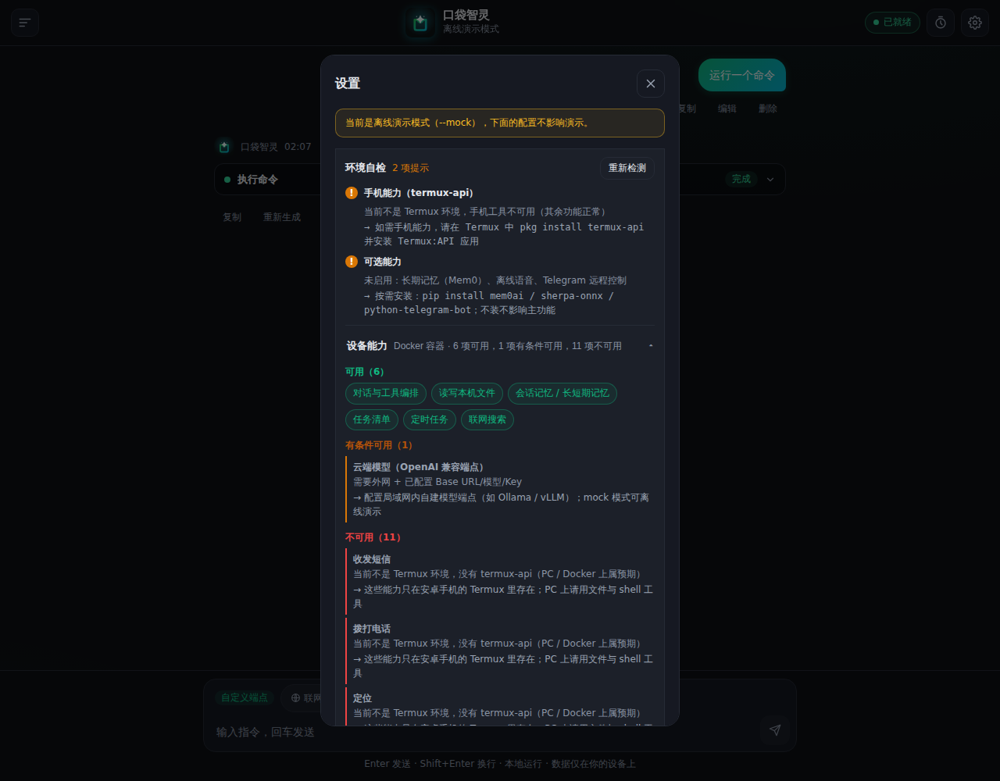

<div align="center">
  
  <h1>PocketMind · 口袋智灵</h1>
  <p><b>口袋里能真正操作你手机的 always-on Agent</b> —— 本地优先 · 隐私保护 · Termux 原生</p>
  
  
  
  
  <br />
  <sub>Web UI · PWA · APK · MCP Server · Telegram 网关 · 定时配方 · Plan/Act 双模式</sub>
</div>

[English](README.md) | **简体中文**

---

## 亮点

- **住在手机里，数据不出本机**：会话、记忆、定时任务、文件备份全部落在本地 SQLite（600/700 权限），只有推理请求发到你配置的 LLM 端点；
- **38 个手机工具**：电量 / 短信 / 拨号 / 定位 / 传感器 / shell / 文件（termux-api），外加任务清单、FTS5 知识库、档案记忆与技能；
- **审批是安全模型，不是 UI 点缀**：三级授权（允许一次 / 本会话始终 / 全局）+ 全局拒绝名单，服务端强制执行；超时自动拒绝，外部 MCP 工具永远跳不过审批；
- **桌面 / Telegram 远程遥控**：内置 stdio MCP Server 把 38 个工具暴露给 Claude Desktop / Cline / Codex；Telegram 网关可让 agent 从任何设备驱动与审批；
- **手机端零 Node**：构建好的 `dist/` 直接入库，Termux 里只跑 `install.sh`；可装成 PWA，也可打 WebView 壳 APK（`termux/apk-shell/`）；
- **验证而非口号**：`bash tests/run_all.sh` 一条命令跑完 32 个后端回归套件 + 前端类型检查、67 个单测、生产构建与 dist 新鲜度检查；全部通过才返回 0。

## 什么设备能做什么

能力取决于运行环境，**装之前请先看** [docs/capability-matrix.md](docs/capability-matrix.md)：
它明确写了哪些工具只在真实安卓手机上存在、模拟器上为什么没有、Docker/VPS/桌面缺哪些。
同样的矩阵随时可在程序内查看：设置 → 环境自检 → 设备能力（`GET /api/diagnostics`）。

一句话：对话 / 文件 / 记忆 / 任务清单 / 定时任务在所有环境都可用；
短信、电话、定位、传感器、电池、拍照需要**真实安卓手机** + termux-api；
联网搜索与云端模型需要外网。

## 架构

```
┌─────────────── 同一台安卓手机 ───────────────┐
│  Web UI（React，agentd 托管，可作 PWA 安装） │
│        ↓ SSE / REST（127.0.0.1:8787）        │
│  agentd（Python · FastAPI，单进程）           │
│    ├─ Agent 循环（流式 → 工具 → 审批 → 回填） │
│    ├─ tools/（shell / 文件 / phone·termux-api）│
│    └─ SQLite（会话 / 消息 / 记忆 / 定时任务）  │
└──────────────────────────────────────────────┘
        ↓ 工具调用                 ↓ 推理请求
   termux-api（通知/短信/定位/传感器…）   外部 LLM（豆包/DeepSeek/千问/Kimi/智谱/硅基流动…）
```

- **全部数据在本机**：会话、消息、记忆摘要、定时任务、文件备份都存本地 SQLite，权限 600/700，重启不丢上下文；
- **LLM 只负责推理**：通过 OpenAI 兼容端点调用，`base_url` + `api_key` 在页面「设置」里配置；
- **工具审批由服务端强制**：写文件 / shell / 发短信 / 拨号等危险操作需在界面确认，超时自动拒绝。

---

## 界面预览

<p align="center">
  
  <br />
  <sub>审批是安全闸门，不是提示条：工具名说人话、危险操作带红色标签、
  主决策与次决策分组、超时自动拒绝倒计时。</sub>
</p>

<p align="center">
  
  <br />
  <sub>环境自检 + 设备能力矩阵：这台设备能做什么、不能做什么、每一项该补什么。</sub>
</p>

<p align="center">
  
  <br />
  <sub>设置面板 · 主题 / 智能体模式 / 模型 / 权限与安全 / 上下文与记忆 / MCP</sub>
</p>

<p align="center">
  
  <br />
  <sub>定时任务 · 配方一键创建（低电量提醒 / 每日总结 / 每日天气）</sub>
</p>

<p align="center">
  
  <br />
  <sub>390&times;844 · 触摸目标 &ge; 36px、无横向溢出、适配安全区</sub>
</p>

---

## 快速开始

### 方案 A：网页版（推荐，无需 APK）

```bash
# 1. 手机侧一次性准备（Termux 里执行）
pkg install git python termux-api
git clone <本仓库地址> && cd pocketmind
bash termux/install.sh          # 装 Python/编译工具链 + 依赖 + 数据目录（pydantic-core 首次需用 Rust 现场编译，约 3-8 分钟）

# 2. 启动服务
bash termux/start.sh            # 默认 http://127.0.0.1:8787

# 3. 浏览器打开 http://127.0.0.1:8787
#    右上角 ⚙ 设置：选模型厂商 → 填 API Key → 保存 → 开聊
```

> 手机浏览器访问同一 WiFi 下的服务：`bash termux/start.sh 8787 --lan`（务必先在设置里配置访问令牌）。

### 方案 B：本机开发 / 体验（不需要手机）

```bash
# 离线演示模式（不消耗 API，验证完整链路）
cd pocketmind
AGENT_HOME=/tmp/pa python3 -m agentd.main --mock --port 8787
# 浏览器打开 http://127.0.0.1:8787 ，发「帮我看看电池 / 读一下最近短信」即可看到工具链路

# 真实模式（需先在设置里配 LLM）
AGENT_HOME=/tmp/pa python3 -m agentd.main --port 8787
```

---

## 目录

| 路径 | 说明 |
|------|------|
| `agentd/` | **唯一服务端**：FastAPI（`main.py`）+ Agent 循环（`agent.py`）+ 工具（`tools/`）+ 存储/调度 |
| `agentd/web/` | React 前端（Vite+TS），构建产物 `dist/` 由 agentd 直接托管 |
| `termux/` | 手机端：`install.sh` 一键装依赖 / `start.sh` 启动 / `boot.sh` 开机自启 |
| `config/` | 预设配方 `recipes.json`（定时任务模板）；LLM 厂商预设见 `agentd/config.py` 的 `PRESETS` |
| `smoke/` | 回归测试 28 个套件（agent 深度 / 排队 / 定时任务 / 安全 / 配方 / MCP / Telegram / 横向审计 / 审批单测；POSIX 专用检查在非 Linux 上记为「跳过」而非失败），全部由 `tests/run_all.sh` 统一调度 |

---

## 日常使用

```bash
bash termux/start.sh            # 启动（或 python3 -m agentd.main --port 8787）
bash termux/start.sh --lan      # 局域网访问（需先配访问令牌）
```

## 数据边界与安全

- **本地**：agent 代码、会话、文件读写、shell 执行、termux-api 调用、定时任务；
- **云端（仅推理）**：LLM API。agent 上下文可能携带本地文件内容，敏感文件请自行做白名单/脱敏；
- 默认只监听 `127.0.0.1`；`--lan` 强制要求访问令牌；
- 权限模式默认「逐次审批」：危险操作需界面确认，超时（默认 120s，可调）自动拒绝；
- 写文件 / 删文件执行前自动备份，对话里可一键撤销（`/api/undo`）。

## Plan / Act 双模式

参考 Cline 的交互设计，agent 支持两种运行模式：

- **Act（直接执行，默认）**：收到消息后直接调用工具、执行操作、返回结果。
- **Plan（先计划后执行）**：agent 先输出执行计划（含计划调用的工具列表），不实际执行；你在界面上点「批准并执行」后切回 Act 模式重发，或点「修改计划」回到输入框调整。

**切换方式**：设置面板 → 「智能体模式」切换，或 `PUT /api/settings {"agent_mode": "plan"}`。
Plan 模式下 SSE 会发 `{"type": "plan", "plan": "...", "tool_calls": [...]}` 事件，`done.stop_reason` 为 `"plan"`。

## 配方（Recipe）一键创建定时任务

预设任务配方定义在 `config/recipes.json`，目前内置：低电量提醒、每日总结、每日天气、午饭提醒。

- **查看配方**：`GET /api/recipes` 返回配方列表及每个配方是否已应用（`applied`）。
- **一键创建**：`POST /api/recipes/{id}/apply` 根据配方实例化为定时任务（幂等，重复调用返回同一 job）。
- 前端「定时任务」面板顶部列出配方，点「一键创建」即可。
- 配方支持 `interval`（秒）和 `cron`（分 时 日 月 周）两种触发方式，以及 `battery < N` 条件触发。

## Telegram 远程控制

在电脑或其它设备上，用 Telegram 直接给手机里的 agent 发消息、批审批。

**1. 创建 bot 拿 token**：找 Telegram 里的 `@BotFather` → `/newbot` → 拿到 bot token（形如 `123456:ABC-xxx`）。再向你自己的 bot 发任意一条消息，然后访问
`https://api.telegram.org/bot<TOKEN>/getUpdates`，从 `chat.id` 里拿到你自己的 chat_id。

**2. 配置（二选一）**：
- 命令行启动：
  ```bash
  python3 -m agentd.main --tg-token 123456:ABC-xxx --tg-chat-id 你的chat_id
  ```
- 或写进配置文件 `$AGENT_HOME/config.json` 的 `server` 段：
  ```json
  { "server": { "tg_token": "123456:ABC-xxx", "tg_chat_id": "你的chat_id" } }
  ```

**3. 使用**：直接给 bot 发文字（如「看下现在电量」「读一下最近五条短信」），agent 跑完会把结果发回 Telegram。

**审批流程**：遇到写 / 危险操作（发短信、拨号、写文件、shell…），bot 会弹一张带
**✅ 允许 / ❌ 拒绝** 按钮的卡片，点按钮即完成审批；120s 不点自动拒绝。只有配置的
`chat_id` 白名单能驱动 agent，其它人发消息一律忽略。

> 未装 `python-telegram-bot` 或未配 token 时，主服务照常启动，只是不启用这个入口。
> 安装：`pip install "python-telegram-bot>=20.0"`（可选依赖）。

## MCP Server（远程控制手机）

把手机上的工具（电量 / 短信 / 定位 / 文件 / shell / 任务清单 / 知识库 / 技能等 38 个）暴露成标准 MCP tools，
让桌面端的 **Claude Desktop / Cline / Codex** 通过 stdio 直接调用，等于用桌面大模型远程操控这台手机。

**启动（独立模式，不启 FastAPI）**：
```bash
python3 -m agentd.mcp_server        # 等价：python3 -m agentd.main --mcp-server
```
传输为 stdio（MCP 默认），通常不需要你手动跑——由桌面端作为子进程拉起。

**在 Claude Desktop 里接入**：编辑配置文件
（macOS: `~/Library/Application Support/Claude/claude_desktop_config.json`，
Windows: `%APPDATA%\Claude\claude_desktop_config.json`），加入：
```json
{
  "mcpServers": {
    "pocket-agent": {
      "command": "python3",
      "args": ["-m", "agentd.mcp_server"],
      "cwd": "/path/to/pocketmind"
    }
  }
}
```
Cline / Codex 同理：在它们的 MCP 配置里加一条 stdio server，command=`python3`、
args=`["-m", "agentd.mcp_server"]`、cwd 指向本仓库根目录。

**工具说明**：动态读取 `agentd/tools/` 注册表，工具名与网页端一致（`get_battery`、
`read_sms`、`run_shell` 等）；每个工具的 description 带风险前缀——
`[safe]` 只读直跑，`[write]` / `[danger]` 桌面端模型应谨慎、高危操作需确认。

## 验证（本地门禁）

一条命令跑完整个门禁——与仓库此前在 GitHub Actions 上执行的是同一套检查：

```bash
bash tests/run_all.sh              # 后端 + 前端
bash tests/run_all.sh --backend    # 只跑后端
bash tests/run_all.sh --with-e2e   # 追加 Playwright（需先装浏览器）
```

全部通过才返回 0；有失败项会在末尾汇总列出，并返回非 0。

- **后端**——32 个 Python 套件，外加 compileall、ruff 与部署链路自检：p0 回归 / p4 agent 深度 / 审批单测 /
  p3 健壮性单测 / 安全专项 / p3 性能与泄漏 / MCP / Telegram / p7 横向审计 /
  p6 首次使用（未配模型）均无需起服务；m5 / p0 排队 / p1 定时任务 / p2 配方 /
  p3 健壮性 API / p5 前端契约对活动 mock 服务执行（服务跑在自动挑选的空闲端口 +
  faketermux 桩）。最后跑部署链路自检（`--lan` 无令牌拒启 / `AGENT_TOKEN` 引导 /
  `--clear-token` 恢复）。
- **前端**——`tsc -b --noEmit` + 67 个 Vitest 单测 + 生产构建 +
  dist 新鲜度检查（提交的 `dist/` 必须与当前源码一致，因为手机不做构建）。
- **E2E**——Playwright（8 视口移动适配矩阵），用 `--with-e2e` 显式开启，
  首次需 `npx playwright install chromium`。每次运行都用独立的空数据目录，
  webServer 也强制自起，不会复用上一轮残留的 mock 实例（那会带进别人的
  `permission_mode` 与会话历史）。

逐个套件的说明见 `smoke/README.md`。

全维度审查（安全 / 可靠性 / 性能 / 测试有效性 / 竞品对标）见
[docs/audit-report-2026-10-22.md](docs/audit-report-2026-10-22.md)——
每条发现都带 `file:line` 证据，并明确列出**没有**验证的部分。也可以单独跑某个套件——
需要服务的那些从环境变量 `AGENTD_BASE` 读取服务地址（默认 `http://127.0.0.1:8799`）。

已在 Windows（Git Bash）与 Linux（Ubuntu 24.04，Python 3.12 / Node 22）双平台实测：
Linux 下 21 项全过且零跳过；计入 Playwright E2E 为 22/22。

## License

Apache-2.0（本仓库实现见 [LICENSE](LICENSE)）
